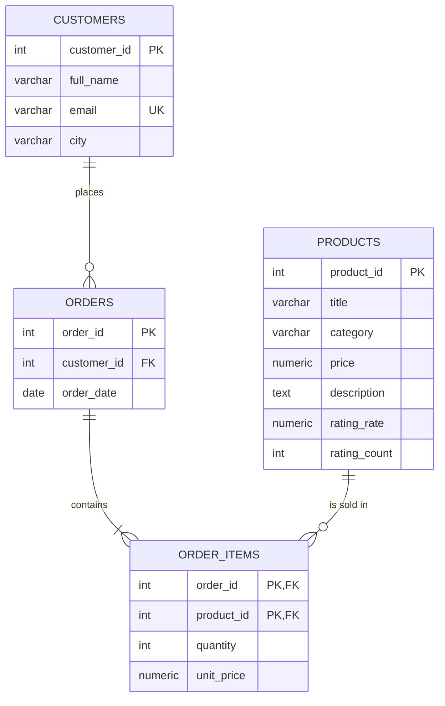

# E-commerce Data Pipeline

A small data engineering project in Python.

```
REST API (Fake Store API) -> JSON -> pandas -> Parquet ----------------+
                                                                        v
sales CSV (dirty) -> cleaning with pandas + pandera quality check -> PostgreSQL
                                                                (products, customers,
                                                                 orders, order_items)
```

## Data source

- **Products:** `https://fakestoreapi.com/products` - public REST API, no key needed, 20 products (`id` 1-20).
- **Sales:** `data/raw/sales_raw.csv` - a small file created by `make_sales_csv.py` from the real product IDs.
  It contains problems on purpose: duplicate rows, missing values, wrong data types, mixed date formats,
  messy text, a negative quantity and an unknown product ID.

## Project structure

```
data/raw/                    original data (not edited by hand)
data/processed/              files created by the pipeline (not in Git)
sql/schema.sql               tables, keys, constraints, indexes
sql/queries.sql              demo queries
src/ecommerce_pipeline/
    config.py                paths, API URL, database settings
    ingest_api.py            stage 1: API -> raw JSON -> Parquet
    make_sales_csv.py        stage 2a: create the dirty sales CSV
    clean_sales.py           stage 2b: cleaning
    schemas.py               pandera quality rules
    load_db.py               stage 3: load into PostgreSQL
    run_pipeline.py          runs all stages
tests/test_pipeline.py       pytest tests
docs/TEAMWORK.md             Git workflow for the team
```

## Setup

Requirements: Python 3.10+, PostgreSQL 14+.

```bash
python -m venv .venv
# Windows PowerShell:  .\.venv\Scripts\Activate.ps1
# macOS / Linux:       source .venv/bin/activate
python -m pip install -r requirements.txt
```

Create an empty database (once):

```sql
CREATE DATABASE ecommerce;
```

Copy `.env.example` to `.env` and write your PostgreSQL password. Never commit `.env`.

## Run

```bash
python src/ecommerce_pipeline/run_pipeline.py
```

Useful options and single stages:

```bash
python src/ecommerce_pipeline/run_pipeline.py --skip-load   # no database, only files
python src/ecommerce_pipeline/ingest_api.py
python src/ecommerce_pipeline/make_sales_csv.py --overwrite
python src/ecommerce_pipeline/clean_sales.py --input data/raw/sales_raw.csv --output data/processed/sales_clean.csv
python src/ecommerce_pipeline/load_db.py
```

`load_db.py` runs `sql/schema.sql`, which **drops and recreates** the four tables
(`products`, `customers`, `orders`, `order_items`). Use a dedicated database.

Results of cleaning are saved to `data/processed/`:
`sales_clean.csv`, `sales_rejected.csv` (removed rows with a reason), `cleaning_report.json` (numbers).

## Tests

```bash
python -m pytest tests -v
```

## Cleaning rules

| Problem | What the code does |
|---|---|
| Exact duplicate rows | removed |
| Extra spaces, UPPER/lower case in names, emails, cities | `strip()`, `title()`, `lower()` |
| Price like `25,50` | decimal comma replaced, converted to number |
| Quantity as a word (`two`) | converted to `2` |
| Dates `25.10.2026` and `2026-10-25` | both parsed, saved as `YYYY-MM-DD` |
| Missing date / name / email in one line | copied from another line of the same order |
| Missing price | taken from the product's catalogue price (API) |
| Missing quantity, or missing order details with no other line | row removed |
| Unknown `product_id` (not in the API data) | row removed |
| Quantity <= 0 or not a whole number | row removed |
| Same product twice in one order | second row removed |

After cleaning, a pandera schema checks types, positive values, valid product IDs and unique
`(order_id, product_id)`.

## Data model



`products.price` is the current catalogue price. `order_items.unit_price` is the price at the time of purchase.

## Demo query

```sql
SELECT p.product_id, p.title,
       SUM(oi.quantity) AS units_sold,
       SUM(oi.quantity * oi.unit_price) AS total_sales
FROM order_items AS oi
JOIN products AS p ON p.product_id = oi.product_id
GROUP BY p.product_id, p.title
ORDER BY total_sales DESC;
```

More queries are in `sql/queries.sql`.

## Team workflow

See `docs/TEAMWORK.md`.
